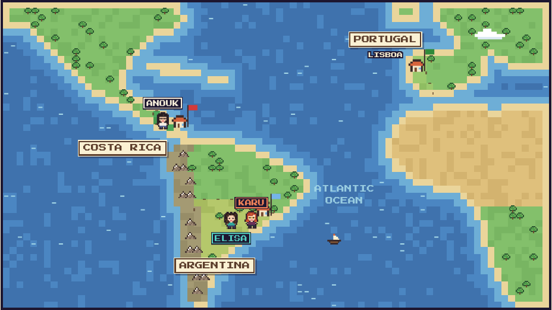

<div align="center">
  

  <h1>Lendara · A Pixel Journey</h1>

  <p><b>From LATAM to Lisbon, in 16 bits.</b></p>

  <a href="https://lendara-org.github.io/lendara-pixel-journey/"><b>▶ Play it</b></a>
  ·
  <a href="https://lendara-shield.duckdns.org/en">Lendara</a>
  ·
  <a href="https://github.com/Lendara-Org/lendara-shield">Lendara Shield repo</a>

  <br><br>

  <a href="https://lendara-org.github.io/lendara-pixel-journey/"></a>
</div>

## About

Three builders, two countries, one mission. A tiny retro RPG that tells how we traveled from Costa Rica and Argentina to Lisbon to build **Lendara on Stellar**.

Five short scenes, under two minutes.

## The team

| | | | |
|---|---|---|---|
| **Anouk Rímola** | 🇨🇷 Costa Rica | [LinkedIn](https://www.linkedin.com/in/anouk-r%C3%ADmola-b9915a223/) | [X](https://x.com/Anouk_Rimola) |
| **Elisa Araya** | 🇦🇷 Argentina | [LinkedIn](https://www.linkedin.com/in/arayamariaelisa/) | [X](https://x.com/ar3lisa) |
| **Karen Giannetto** (Karu) | 🇦🇷 Argentina | [LinkedIn](https://www.linkedin.com/in/karen-giannetto/) | [X](https://x.com/karu_giann) |

## Run it

```bash
npm install
npm run dev
```

<sub>React + Vite · pixel art hand-built in SVG</sub>
